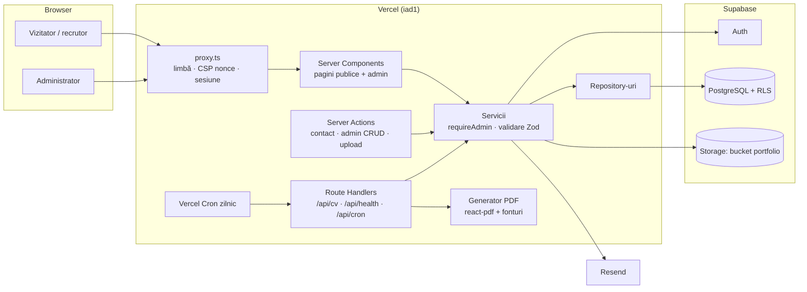
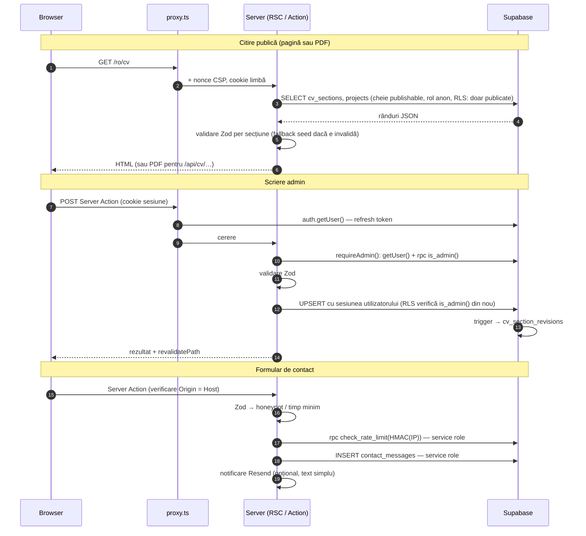
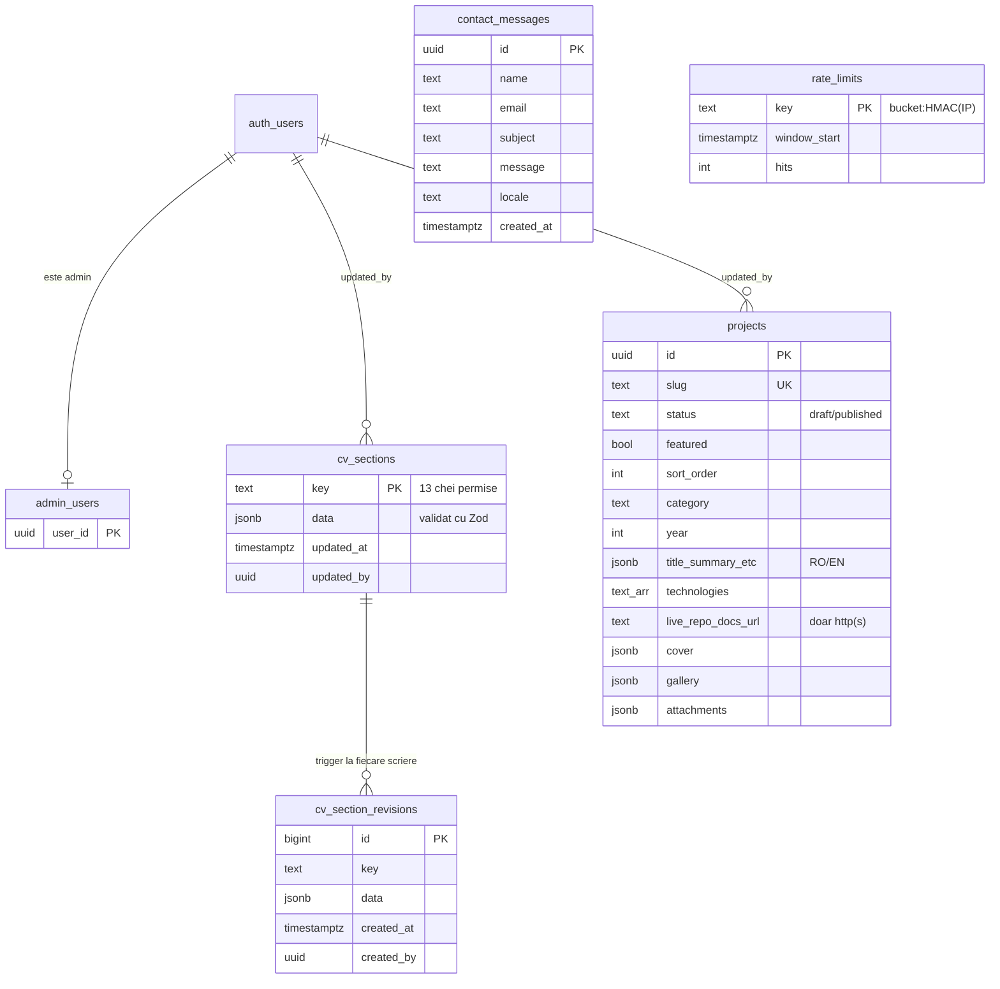

# Arhitectura software

## 1. Obiective și constrângeri

- Site public rapid, bilingv, cu SEO bun și care funcționează și când baza de date nu este disponibilă.
- Un singur administrator; conținut modificabil fără deploy.
- CV-uri PDF generate din aceeași sursă de adevăr ca site-ul (fără documente care rămân în urmă).
- Securitate în profunzime: validare pe server, autorizare pe server, RLS în baza de date.
- Costuri minime de operare: planuri gratuite Vercel Hobby + Supabase Free sunt suficiente.

## 2. Stack și justificare

| Alegere | De ce | Alternative respinse |
|---|---|---|
| **Next.js 16 (App Router) + React 19** | SSR pentru SEO, Server Components (zero JS pentru conținut static), Server Actions cu protecție CSRF integrată, Route Handlers pentru PDF. Integrare nativă cu Vercel. | SPA (SEO slab), Astro (lipsesc Server Actions pentru admin) |
| **TypeScript strict** | `noUncheckedIndexedAccess`; dicționarul EN este verificat la compilare față de RO (nicio traducere nu poate lipsi). | — |
| **Tailwind CSS 4** | Tokenuri de design în CSS (`@theme`), dark mode prin `data-theme`, CSS mic. | CSS-in-JS (incompatibil cu CSP strict fără efort) |
| **Zod 4** | O singură definiție a schemelor, folosită la scriere (server), la citire (DB → UI) și în teste. | Validare manuală |
| **Supabase** | PostgreSQL cu RLS (autorizare în baza de date), Auth gata făcut (parole hash-uite, rate limit propriu, MFA disponibil), Storage cu politici. Un singur furnizor pentru 3 nevoi. | Firebase (fără SQL/RLS), DB propriu pe VM (mentenanță, backup) |
| **@react-pdf/renderer** | PDF vectorial cu text real (selectabil, parsabil ATS), fonturi TTF încorporate (diacritice ș/ț), paginare automată, rulează în funcții serverless. | Puppeteer/Chromium (prea mare pentru Vercel Functions, lent), jsPDF (layout manual) |
| **sharp** | Re-codare a imaginilor încărcate (elimină EXIF/GPS, neutralizează fișiere poliglot). | — |
| **Resend (opțional)** | Notificare e-mail printr-un singur `fetch`, fără SDK. | SMTP (secrete mai multe, livrabilitate slabă) |
| **Vercel** | Preview pentru fiecare PR, rollback instant, HTTPS automat, cron. | VM Google Cloud (vezi `OPERATIONS.md` §7) |

Dependențe de producție: 10 pachete (`next`, `react`, `react-dom`, `@supabase/ssr`, `@supabase/supabase-js`, `@react-pdf/renderer`,
`zod`, `sharp`, `lucide-react`, `server-only`). Fără biblioteci de i18n, animație sau formulare — nu au fost necesare (YAGNI).

## 3. Straturi (Separation of Concerns)

| Strat | Director | Responsabilitate | Poate importa |
|---|---|---|---|
| Prezentare | `src/app`, `src/components` | Rute, layout, UI, formulare | servicii, domeniu, lib |
| Logică (servicii) | `src/server/services` | Validare, reguli, **autorizare** (`requireAdmin`), orchestrare | repository-uri, domeniu |
| Acces date | `src/server/repositories` | Interogări Supabase (parametrizate prin PostgREST), mapare rânduri | clienți |
| Autentificare | `src/server/auth.ts`, `src/proxy.ts` | Sesiune, verificare JWT cu serverul Auth, rol de admin | clienți |
| Stocare fișiere | `src/server/services/storage-service.ts`, `src/lib/security/file-validation.ts` | Validare magic bytes, re-codare, încărcare | clienți |
| Generare PDF | `src/pdf` | Model de document independent de format + 4 șabloane | domeniu, i18n |
| Integrări externe | `src/server/services/email-service.ts` | Resend | env server |
| Domeniu | `src/domain` | Tipuri și scheme Zod, date seed | — |

Fișierele din `src/server` importă `server-only`: dacă ar fi importate accidental într-o componentă client, build-ul eșuează. Secretele
(`src/server/env.server.ts`) nu pot ajunge în bundle-ul din browser.

Principii aplicate: **SRP** (un repository per tabel, un serviciu per caz de utilizare), **DRY** (un model PDF pentru 4 formate, un editor
generic pentru 13 secțiuni CV, schemele Zod reutilizate peste tot), **KISS** (filtrarea portofoliului prin URL, fără state management),
**erori centralizate** (`AppError` + coduri traduse în UI, nicio eroare internă afișată vizitatorilor), **fail secure** (fără configurare,
admin-ul și formularul sunt blocate, nu deschise).

## 4. Diagrama componentelor

## 5. Fluxuri de date

## 6. Diagrama bazei de date

Funcții SQL (`SECURITY DEFINER`, `search_path = ''`): `is_admin()` (anon/authenticated), `check_rate_limit()` și `purge_expired_data()`
(doar `service_role`), `record_cv_revision()` (trigger; păstrează ultimele 50 de versiuni per secțiune).

De ce secțiuni JSON și nu tabele normalizate pentru CV: fiecare secțiune este editată și salvată atomic, are istoric gratuit (backup și
restaurare din panou) și este validată de aceeași schemă ca PDF-ul. Proiectele au tabel propriu deoarece au URL-uri, stare de publicare,
ordonare și fișiere.

## 7. Internaționalizare

- Rute `/{ro|en}/…`; `/` redirecționează după cookie-ul `NEXT_LOCALE` sau `Accept-Language`.
- Interfața: `src/i18n/dictionaries.ts` (EN este tipizat după RO). Conținutul: câmpuri `{ ro, en }` în baza de date.
- SEO: `canonical`, `hreflang` (ro, en, x-default), Open Graph per limbă, sitemap cu alternative, JSON-LD `Person`.

## 8. Caching și performanță

Paginile sunt randate dinamic (nonce CSP per cerere); datele sunt deduplicate per cerere (`React.cache`). Conținutul fiind mic (câțiva KB),
o interogare per pagină este mai simplă și mai sigură decât un cache cu invalidare. PDF-urile au `s-maxage=60` pe CDN.
Imaginile: `next/image` (AVIF/WebP, dimensiuni responsive), portretul are placeholder blur; fonturile sunt self-hosted de `next/font`.
