# CI/CD

## 1. Mecanism unic de deployment

**Vercel — integrarea Git nativă** este singurul mecanism de deployment (fără `vercel deploy` din GitHub Actions, deci fără mecanisme
concurente și fără token Vercel stocat în GitHub):

- fiecare Pull Request → **Preview Deployment** cu URL propriu;
- push / merge pe branch-ul de producție → **Production Deployment** pe `ciupiustefan.com`;
- **rollback** instant din Vercel (vezi `OPERATIONS.md` §4).

GitHub Actions face verificările: înainte de merge (CI obligatoriu prin branch protection) și după deployment (smoke tests + ZAP).

## 2. Diagramă

```mermaid
flowchart LR
  Dev[Commit / PR] --> CI
  subgraph CI["GitHub Actions — ci.yml + security.yml (fără secrete)"]
    Q[quality: lint · typecheck · unit · integrare · build]
    D[database: migrații + seed + 37 aserțiuni RLS pe Postgres 16]
    E[e2e: Playwright desktop + mobil + axe]
    A[audit: npm audit]
    S[secrets: Gitleaks pe tot istoricul]
    C[codeql: security-extended]
  end
  CI -->|toate verde| BP{Branch protection<br/>review + checks obligatorii}
  BP -->|merge| V[Vercel build + deploy]
  Dev -->|PR| VP[Vercel Preview]
  V -->|deployment_status: success| PD
  VP -->|deployment_status: success| PD
  subgraph PD["post-deploy.yml"]
    H[health check /api/health cu retry]
    SM[smoke tests @smoke]
    Z[OWASP ZAP baseline — doar Production]
  end
  PD -->|eșec| RB[Rollback instant în Vercel]
```

## 3. Workflow-uri

| Fișier | Declanșatori | Joburi | Permisiuni |
|---|---|---|---|
| `.github/workflows/ci.yml` | `pull_request`, `push` (orice branch, exceptând modificări doar în docs), manual | `quality`, `database`, `e2e`, `audit` | `contents: read` |
| `.github/workflows/security.yml` | PR, push (orice branch), săptămânal (luni 04:23 UTC), manual | `secrets` (Gitleaks), `codeql` | `contents: read`; `security-events: write` doar pentru CodeQL |
| `.github/workflows/post-deploy.yml` | `deployment_status` (trimis de Vercel) | `smoke`, `zap` | `contents: read`; `issues: write` doar pentru ZAP |
| `.github/dependabot.yml` | săptămânal | actualizări npm (grupate minor/patch) și GitHub Actions | — |

Pipeline-ul eșuează dacă oricare verificare obligatorie eșuează (lint, tipuri, teste, build, RLS, E2E, `npm audit --omit=dev --audit-level=high`,
Gitleaks). `npm audit` pentru dependențele de dezvoltare este doar raportat.

## 4. Securitatea GitHub Actions

- **Least privilege**: `permissions: contents: read` la nivel de workflow; drepturi suplimentare doar pe jobul care le cere.
- **Actions externe fixate pe SHA de commit** (cu versiunea în comentariu); Dependabot propune actualizări.
- `actions/checkout` cu `persist-credentials: false`.
- **Niciun secret în CI**: testele rulează în modul fallback; PR-urile din fork-uri nu au acces la nimic sensibil.
- `post-deploy.yml` rulează la `deployment_status`; GitHub folosește definiția workflow-ului din branch-ul implicit, deci codul din PR nu
  poate modifica ce rulează acolo. Singurul secret opțional este `VERCEL_AUTOMATION_BYPASS_SECRET` (acces la preview-urile protejate).
- `timeout-minutes` pe fiecare job; `concurrency` anulează rulările depășite.
- Joburile de testare sunt separate de deployment (deployment-ul îl face Vercel).

## 5. Secrete

| Unde | Secret | Necesar | Cum îl obții |
|---|---|---|---|
| GitHub → Settings → Secrets and variables → Actions | `VERCEL_AUTOMATION_BYPASS_SECRET` | Opțional (doar dacă preview-urile au Deployment Protection) | Vercel → Project → Settings → Deployment Protection → Protection Bypass for Automation |
| Vercel → Project → Settings → Environment Variables | toate variabilele din `.env.example` | Da | vezi `DEPLOYMENT.md` §3 |

Nu pune niciodată `SUPABASE_SECRET_KEY` în GitHub. Secretele nu apar în loguri: niciun workflow nu le afișează, iar GitHub le maschează.

## 6. Branch protection (de configurat manual)

> Notă: repository-ul era gol, așa că primul push a făcut ca `claude/sweet-newton-fxxmx3` să devină branch-ul implicit. Recomandare:
> creează `main` din acest branch, setează-l ca implicit (Settings → General → Default branch) și ca **Production Branch** în Vercel.

GitHub → Settings → Branches → Add rule (sau Rulesets) pentru `main`:

1. Require a pull request before merging — 1 approval dacă există alt reviewer; dismiss stale approvals.
2. Require status checks to pass: `Lint · Types · Unit · Integration · Build`, `Database & RLS tests`, `End-to-end (Playwright)`,
   `Dependency audit`, `Secret scanning (Gitleaks)`, `Static analysis (CodeQL)`; „Require branches to be up to date”.
3. Require conversation resolution; block force pushes; restrict deletions.
4. Opțional: Require signed commits; Do not allow bypassing the above settings.
5. Settings → Actions → General: „Read repository contents permission” ca permisiune implicită pentru `GITHUB_TOKEN`; dezactivează
   „Allow GitHub Actions to create and approve pull requests”.

## 7. Verificări înainte și după publicare

- **Înainte**: CI complet pe PR + Preview Vercel (verificare vizuală a site-ului și a PDF-urilor pe URL-ul de preview).
- **După**: `post-deploy.yml` — health check cu 5 reîncercări, smoke tests (pagini, descărcare PDF, protecție admin, antete, SEO),
  ZAP baseline pe producție. La eșec: rollback (secțiunea următoare).

## 8. Rollback

Vezi `OPERATIONS.md` §4 (Vercel Instant Rollback, `git revert`, restaurarea conținutului din istoricul de versiuni).
