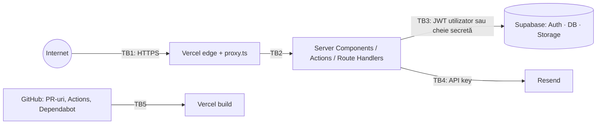

# Securitate — Threat Model și raport de audit

> Actualizare 03.11.2026: auditul complet și remedierile (brute force distribuit, MFA admin aplicat în aplicație și în baza de date,
> limite globale, dovada consimțământului, cereri GDPR) sunt în [`AUDIT-2026-11.md`](AUDIT-2026-11.md).

> Data auditului: 3 noiembrie 2026 · Versiune auditată: commit-ul din branch-ul `claude/sweet-newton-fxxmx3`
> Aplicația **nu este declarată 100% sigură**. Acest raport descrie verificările efectuate efectiv, rezultatele lor și riscurile reziduale.
> Verificările care necesită mediul de producție (Supabase real, Vercel, domeniu) sunt marcate **„neefectuat”** și trebuie rulate după deployment.

## 1. Principii aplicate

| Principiu | Implementare |
|---|---|
| Security by Design | Threat model înainte de implementare; validare Zod, RLS și CSP proiectate din prima iterație |
| Privacy by Design | Telefon ascuns implicit; IP-ul nu este stocat (doar HMAC); retenție automată 180 zile; fără analytics/cookie-uri de tracking |
| Least Privilege | 3 clienți Supabase (anon / sesiune / service); cheia secretă folosită doar pentru contact, rate limit, retenție; GitHub Actions cu `contents: read` |
| Defense in Depth | Proxy → `requireAdmin()` în fiecare serviciu → RLS în PostgreSQL → politici Storage; validare în UI, server și constrângeri SQL |
| Fail Secure | Fără configurare: admin și contact blocate; limitatorul indisponibil ⇒ cererea este respinsă; validare eșuată la citire ⇒ seed, nu date corupte |

## 2. Threat model (STRIDE)

### 2.1 Active

| Activ | Sensibilitate |
|---|---|
| Conținutul CV și proiectele | Integritate ridicată (reputație profesională) |
| Contul de administrator și sesiunea | Critic |
| Mesajele din formularul de contact (nume, e-mail, text) | Date personale ale terților |
| Cheia secretă Supabase, `IP_HASH_SALT`, `CRON_SECRET`, `RESEND_API_KEY` | Critic |
| Fișierele încărcate (imagini, PDF) | Integritate; pot fi vector de atac pentru vizitatori |
| Disponibilitatea site-ului | Medie |

### 2.2 Actori

Vizitator anonim (recrutor) · Bot / atacator anonim · Utilizator autentificat fără rol de admin (dacă înregistrarea ar fi deschisă) ·
Administrator · Furnizori (Vercel, Supabase, Resend, GitHub) · Contribuitor PR / dependență compromisă (supply chain).

### 2.3 Limite de încredere și suprafețe de atac

Suprafețe: paginile publice și parametrii lor (`locale`, `slug`, `?category`); `/api/cv/[locale]/[format]`; `/api/health`;
`/api/cron/retention`; Server Action contact; `/admin/login`; Server Actions admin (CRUD, upload); API-ul Supabase expus public
(cheia publishable este, prin definiție, publică); pipeline-ul CI/CD; dependențele npm.

### 2.4 Amenințări și măsuri

| # | STRIDE | Amenințare | Măsuri implementate | Risc rezidual |
|---|---|---|---|---|
| T1 | Spoofing | Brute force / credential stuffing pe login | Rate limit 10/15 min per HMAC(IP) în Postgres + limitele Supabase Auth; mesaje generice (fără enumerare conturi); parolă min. 8 | Mediu-scăzut — **recomandat: MFA TOTP** (vezi R1) |
| T2 | Spoofing | Sesiune falsificată / cookie furat | `auth.getUser()` validează JWT cu serverul Auth la fiecare cerere; cookie-uri `@supabase/ssr` (HttpOnly, Secure, SameSite=Lax); HSTS | Scăzut |
| T3 | Tampering | Scriere directă în API-ul Supabase cu cheia publică | RLS pe toate tabelele; scriere doar `is_admin()`; `admin_users` fără politici (inaccesibil prin API); testat (§4.5) | Scăzut |
| T4 | Tampering / EoP | Utilizator autentificat se face admin (privilege escalation) | `admin_users` gestionat doar din SQL; `is_admin()` SECURITY DEFINER cu `search_path=''`; testat | Scăzut |
| T5 | Tampering | CSRF pe acțiuni admin / contact | Server Actions: verificare Origin vs Host (Next.js); cookie SameSite=Lax; nicio acțiune mutantă pe GET | Scăzut |
| T6 | Tampering | XSS stocat (conținut admin sau mesaje) | React escapează tot; `dangerouslySetInnerHTML` doar pentru 2 scripturi statice (lint `react/no-danger` = error); URL-uri doar http(s) (Zod + CHECK SQL); CSP cu nonce + `strict-dynamic`; e-mailurile de notificare sunt text simplu | Scăzut |
| T7 | Tampering | SQL Injection | Fără SQL dinamic: PostgREST parametrizat; funcțiile PL/pgSQL nu concatenează SQL | Foarte scăzut |
| T8 | Tampering | Upload malițios (poliglot, SVG cu script, PDF cu JS, bombă de decompresie) | Magic bytes; SVG interzis; imagini re-codate WebP cu sharp (`limitInputPixels`); PDF cu `/JavaScript`, `/OpenAction`, `/Launch`, `/EmbeddedFile` respins; 4 MB; nume UUID generate pe server; bucket acceptă doar `image/webp`, `application/pdf` | Mediu-scăzut — fără antivirus (R3) |
| T9 | Repudiation | Modificări de conținut fără urmă | `updated_by`, `updated_at`; istoric `cv_section_revisions`; loguri structurate ale acțiunilor admin (fără date personale) | Scăzut |
| T10 | Info disclosure | Scurgere de secrete în bundle / loguri / repo | `server-only`; doar `NEXT_PUBLIC_*` în client; logger cu redactare; `.env*` în `.gitignore`; Gitleaks în CI | Scăzut |
| T11 | Info disclosure | IDOR pe proiecte nepublicate / mesaje / fișiere | RLS: anon vede doar `published`; mesajele doar admin; ștergerea unui fișier cere ca path-ul să aparțină proiectului; ID-uri UUID validate | Scăzut. Fișierele din bucket-ul public sunt accesibile dacă URL-ul (UUID) este cunoscut (R4) |
| T12 | Info disclosure | Mesaje de eroare detaliate | `error.tsx` generic; coduri de eroare traduse; `/api/health` raportează doar stări | Scăzut |
| T13 | Info disclosure | Date personale publicate neautorizat | Telefon `showPhone=false`, `showPhoneInPdf=false` implicit; data nașterii, gen, WhatsApp și datele referințelor **nu** sunt publicate | Scăzut |
| T14 | DoS | Spam în formular | Honeypot, timp minim de completare, rate limit 5/oră per IP, limite de lungime | Mediu-scăzut (fără CAPTCHA, R2) |
| T15 | DoS | PDF-uri generate în buclă | Generare ~0,3–0,9 s; cache CDN `s-maxage=60`; limitele Vercel | Mediu (R5) |
| T16 | EoP | Clickjacking | `X-Frame-Options: DENY` + `frame-ancestors 'none'` | Foarte scăzut |
| T17 | Spoofing | Open redirect după login (`?next=`) | `safeRedirectPath`: doar căi relative same-origin; testat unit + E2E | Foarte scăzut |
| T18 | Tampering | SSRF | Aplicația nu face cereri către URL-uri furnizate de utilizator (singurul `fetch` extern: Resend, URL fix) | Foarte scăzut |
| T19 | Tampering | Supply chain (dependențe, Actions) | Actions fixate pe SHA de commit; Dependabot; `npm ci` cu lockfile; `npm audit` în CI; puține dependențe | Mediu (inerent) |
| T20 | EoP | Cod neverificat din PR rulează cu secrete | CI fără secrete; `post-deploy.yml` rulează pe `deployment_status` cu definiția din branch-ul implicit; `persist-credentials: false` | Scăzut |
| T21 | Tampering | Apel neautorizat al job-ului de retenție | `Authorization: Bearer CRON_SECRET`, comparat în timp constant; testat E2E (401) | Foarte scăzut |

## 3. Configurarea de securitate

| Control | Valoare | Unde |
|---|---|---|
| HTTPS / HSTS | `max-age=63072000; includeSubDomains; preload` | `next.config.ts` (Vercel forțează HTTPS) |
| CSP | `script-src 'self' 'nonce-…' 'strict-dynamic'`, `object-src 'none'`, `base-uri 'self'`, `form-action 'self'`, `frame-ancestors 'none'`, `upgrade-insecure-requests` (pe HTTPS) | `src/lib/security/csp.ts`, `src/proxy.ts` |
| Alte antete | `X-Content-Type-Options: nosniff`, `X-Frame-Options: DENY`, `Referrer-Policy: strict-origin-when-cross-origin`, `Permissions-Policy` restrictiv, `COOP: same-origin`, fără `X-Powered-By` | `next.config.ts` |
| Admin | `X-Robots-Tag: noindex`, `Cache-Control: no-store` | `next.config.ts` |
| Cookie-uri | Sesiune Supabase: HttpOnly, Secure, SameSite=Lax; `NEXT_LOCALE`: Secure, SameSite=Lax | `@supabase/ssr`, `proxy.ts` |
| CORS | Niciun antet CORS emis ⇒ browserele blochează cererile cross-origin cu credențiale; Server Actions verifică Origin | implicit |
| Rate limiting | contact 5/h, login 10/15 min, fereastră fixă atomică în Postgres | `check_rate_limit()` |
| Validare server | Zod pe toate intrările; constrângeri CHECK în SQL | `src/domain/**`, migrația |

## 4. Audit — verificări efectuate

| # | Verificare | Instrument / metodă | Rezultat |
|---|---|---|---|
| 1 | Revizuirea arhitecturii | Manual (`ARCHITECTURE.md`) | Efectuat |
| 2 | Threat modeling | STRIDE (§2) | Efectuat |
| 3 | Analiza codului | ESLint (Next, TS, a11y, `no-danger`, `no-explicit-any`) — 0 erori, 0 avertismente; TypeScript strict — 0 erori; revizuire manuală a fiecărui punct de intrare | Efectuat. CodeQL (`security-extended`, JS/TS + Actions) a rulat cu succes în GitHub Actions pe 03.11.2026; eventualele alerte apar în GitHub → Security → Code scanning |
| 4 | Autentificare | Teste E2E: rutele `/admin/*` redirecționează la login; login blocat fără configurare; open redirect neutralizat | Efectuat local. **Login real cu Supabase: neefectuat** (necesită proiectul Supabase) |
| 5 | Autorizare | Teste de integrare: `saveSection`/`listMessages` resping anonim (401) și non-admin (403); validare pe server pentru admin | Efectuat |
| 6 | RLS | 37 de aserțiuni SQL pe PostgreSQL 16 real (rolurile anon/authenticated/service_role emulate): citiri, scrieri, escaladare, funcții privilegiate, storage, retenție | Efectuat — toate trec. **Pe proiectul Supabase real: de rulat** (vezi `DEPLOYMENT.md` §2.5) |
| 7 | Upload | Teste unit: magic bytes, HTML/SVG/EXE deghizate, PDF cu JS/Launch, limită de mărime, nume de fișiere | Efectuat (validare). Upload end-to-end în Storage: **neefectuat** |
| 8 | Dependențe | `npm audit --omit=dev`: **0 vulnerabilități**. `npm audit` complet: 16 moderate, toate tranzitive în ESLint (`minimatch` ReDoS), doar dev | Efectuat |
| 9 | Detectarea secretelor | Scanare regex locală (chei Supabase, JWT, Resend, AWS, GitHub, chei private, parole) — doar fixture-uri de test; Gitleaks în CI pe tot istoricul | Efectuat local + Gitleaks în GitHub Actions pe tot istoricul (03.11.2026): fără scurgeri |
| 10 | HTTPS / TLS | `vercel certs ls` (certificate emise automat pentru apex și www, reînnoire automată, 90 de zile); `curl`: `http://` → 308 `https://`, `www` → 308 apex, HSTS prezent | Efectuat pe `https://ciupitustefan.com` (03.11.2026). Nota SSL Labs: de verificat din browser |
| 11 | Antete HTTP | Test E2E care verifică CSP, XFO, nosniff, HSTS, Referrer-Policy, absența `X-Powered-By` | Efectuat (local). ZAP baseline configurat post-deploy |
| 12 | Testarea API-urilor | Integrare + E2E: `/api/cv` (8 variante, 404 pentru parametri invalizi/path traversal), `/api/health` (fără detalii interne), `/api/cron/retention` (401 fără/cu secret greșit) | Efectuat |
| 13 | Loguri | Logger structurat cu redactare (chei sensibile, e-mailuri); testat unit; mesajele nu sunt logate | Efectuat |
| 14 | Expunerea datelor personale | Inventar (`GDPR.md`); E2E verifică absența telefonului pe CV și în PDF | Efectuat |
| — | OWASP ZAP | Workflow `post-deploy.yml` (baseline pe producție) | **Neefectuat** (necesită URL de producție) |
| — | OWASP ASVS | Folosit ca listă de verificare pentru V2 (Auth), V3 (Sesiune), V4 (Acces), V5 (Validare), V12 (Fișiere), V14 (Config) | Parțial; nu este o certificare ASVS |

## 5. Constatări

| ID | Vulnerabilitate | Severitate | Impact | Dovezi | Remediere | Stare | Risc rezidual |
|---|---|---|---|---|---|---|---|
| F1 | Politică Storage lipsă pentru SELECT ⇒ `remove()` / upsert ar fi eșuat pentru admin | Scăzută (funcțională) | Fișierele nu ar fi putut fi șterse (orfane) | Testul RLS „admin can upload files” a eșuat la prima rulare | Politică `portfolio: admin select` | **Remediat** (test trece) | — |
| F2 | Formularul de contact afișa succes fals și pierdea mesajul când marcajul de timp lipsea sau formularul era vechi | Medie | Pierdere silențioasă de mesaje reale | Test E2E: „Message sent” fără backend | Timestamp setat în acțiunea client; doar honeypot-ul este ignorat silențios; „prea rapid” ⇒ mesaj vizibil; formularele vechi sunt acceptate | **Remediat** (teste unit + integrare + E2E) | — |
| F3 | Grupuri radio cu același `name` în mai multe dialoguri de descărcare | Scăzută | Alegerea limbii/formatului nu funcționa | Test E2E de descărcare | Nume unice (`useId`) | **Remediat** | — |
| F4 | Nume accesibil diferit de textul vizibil (logo, selector limbă) | Scăzută (a11y, WCAG 2.5.3) | Utilizatorii de comandă vocală nu puteau activa linkurile | axe `label-content-name-mismatch` | Text vizibil + `sr-only` | **Remediat** | — |
| F5 | `style-src 'unsafe-inline'` în CSP | Scăzută | Injectare de stiluri (nu de scripturi) dacă ar exista o injecție HTML | Configurație | Acceptat: necesar pentru `next/image` și atributele `style` din React; scripturile rămân blocate prin nonce | **Acceptat** | Scăzut |
| F6 | Vulnerabilitate `minimatch` (ReDoS) în ESLint | Moderată (dev) | Doar în mediul de dezvoltare/CI, la parsarea unor glob-uri controlate de dezvoltator | `npm audit` | Se actualizează prin Dependabot când `eslint-config-next` o permite | **Deschis — acceptat temporar** | Scăzut |

## 6. Riscuri reziduale și recomandări

| ID | Recomandare | Prioritate |
|---|---|---|
| R1 | Activează **MFA (TOTP)** în Supabase Auth pentru contul de administrator și **dezactivează înregistrarea publică** (Auth → Providers → Email → „Allow new users to sign up” = off) | Înaltă |
| R2 | Dacă apare spam, adaugă Cloudflare Turnstile (CSP: `script-src`/`frame-src` pentru `challenges.cloudflare.com`) | Scăzută |
| R3 | Pentru PDF-uri de la terți, scanare antivirus (ex. ClamAV pe VM) — astăzi doar administratorul încarcă fișiere | Scăzută |
| R4 | Fișierele draft sunt publice dacă URL-ul este cunoscut (UUID nepredictibil). Dacă e nevoie de confidențialitate, bucket privat + URL-uri semnate | Scăzută |
| R5 | Activează Vercel Firewall / Attack Challenge Mode la nevoie; rate limit pe `/api/cv` | Scăzută |
| R6 | ~~Teste RLS pe proiectul real, TLS și antete~~ — efectuate pe 03.11.2026 (RLS: toate aserțiunile trec pe Supabase; 13/13 smoke tests pe domeniu). Rămân: ZAP baseline (rulează în `post-deploy.yml`) și SSL Labs | Medie |

## 7. Raportarea vulnerabilităților

Scrie la ciupitustefan12@gmail.com cu subiectul „Security”. Nu deschide issue-uri publice pentru vulnerabilități.
